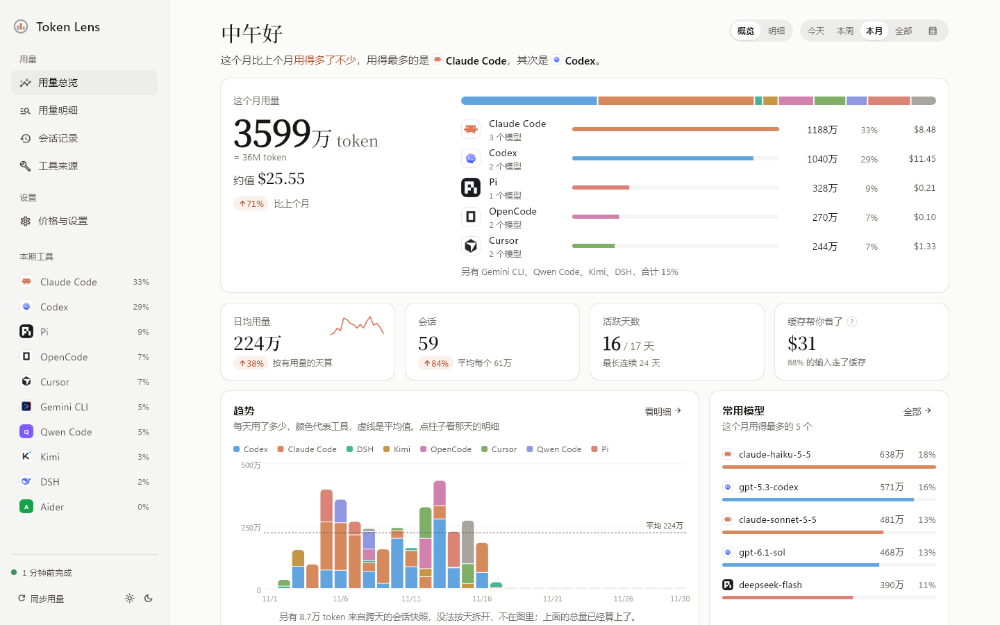
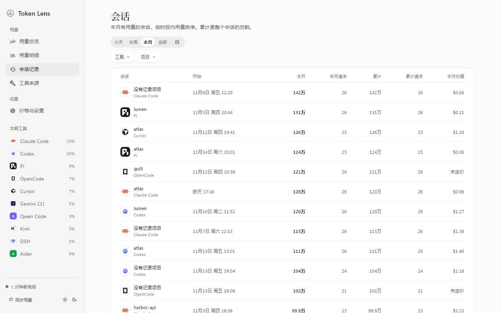
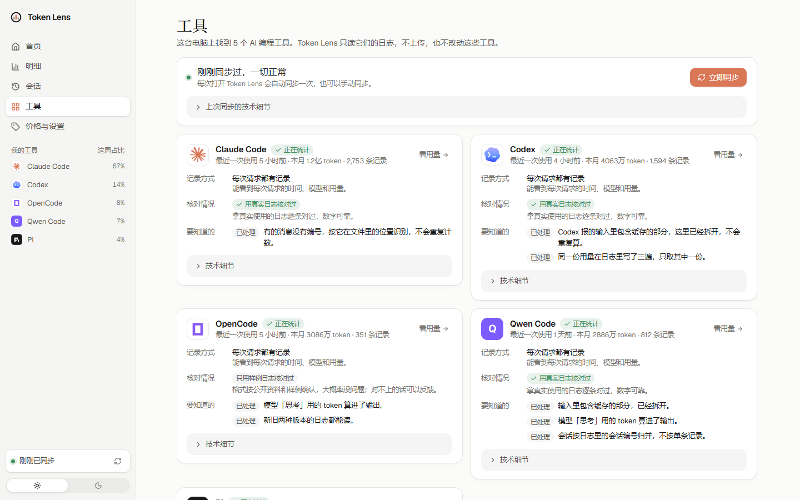
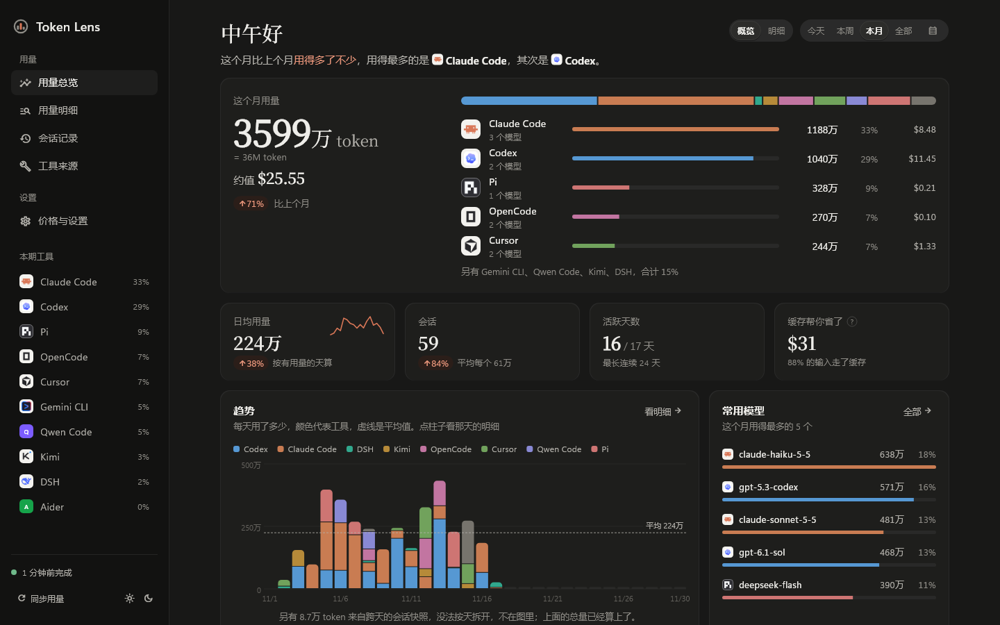
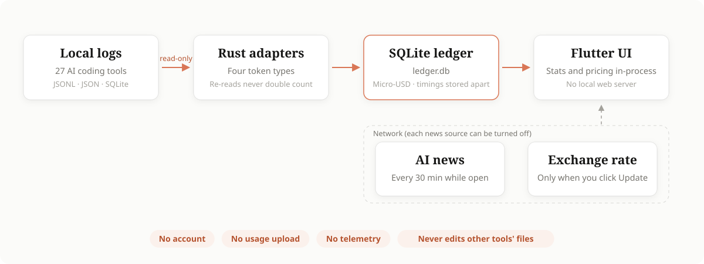

<div align="center">


# Token Lens

Local-only token usage and cost analytics for AI coding tools

[](https://github.com/rumoii/token-lens/stargazers)
[](LICENSE)


[](PRIVACY.md)

**[Installation](#installation)** · [Usage](#usage) · [How It Works](#how-it-works) · [Privacy](PRIVACY.md) · [简体中文](README.md)

</div>

Token Lens reads the logs that 27 AI coding tools, including Claude Code, Codex CLI and Qwen Code, write on your machine. It totals token usage and an estimated cost at list prices, and shows them in a local dashboard, split by tool, model, project and time. On Windows and Apple silicon Macs a desktop app opens the dashboard in its own window; on other systems you open it in your browser. No login, no uploads, zero telemetry.

## Features

- **100% local privacy**: local logs are parsed read-only; zero uploads, zero telemetry, no account.
- **Zero heavy dependencies**: the core uses only Node built-in modules (`node:sqlite` + `node:http`); `dependencies` is empty.
- **Atomic deduplication**: idempotent ingestion via SHA-256 content hashes; amounts are stored as integer micro-dollars.
- **Auto sync**: incremental sync every 5 minutes while `serve` runs, plus one backfill collect on start (skipped when the ledger is empty).
- **27 client adapters**: covering the local logs and local databases of mainstream AI coding clients.
- **Display preferences**: amounts support USD/CNY only; an exchange-rate request requires a click on “Update exchange rates”. Shared shell text supports zh-CN and en; page content is in Chinese.
- **Desktop app**: a single portable exe on Windows (30MB at most) and a dmg for Apple silicon Macs; double-click to open a window, no separate Node install.

## Screenshots

<table>
  <tr>
    <td align="center"><br>Overview</td>
    <td align="center"><br>Detail, split by project</td>
  </tr>
  <tr>
    <td align="center"><br>Sessions</td>
    <td align="center"><br>Tools and verification status</td>
  </tr>
  <tr>
    <td align="center" colspan="2"><br>Dark theme</td>
  </tr>
</table>

Page content is in Chinese, with zh-CN and en shared shell text. The usage in these screenshots is synthetic demo data, and the project paths are made up.

## Supported Tools

| Client | source | Evidence | Notes |
| --- | --- | --- | --- |
| Claude Code | claude | Verified, reconciled (zero diff) | Input excludes cache reads/writes; cache writes priced in 5m/1h tiers (158 comparable) |
| Codex CLI | codex | Verified, reconciled (zero diff) | cached ⊂ input; rollout JSONL (including .zst) (1,251 comparable) |
| Qwen Code | qwen | Verified field-by-field against real samples | Input includes cache and needs subtraction; output merges thoughtsTokens |
| Pi | pi | Verified field-by-field against real samples | Session header and usage are not on the same line |
| DeepSeek Harness (DSH) | dsh | Real samples, pending verification | Session-level cumulative snapshots, full overwrite |
| Grok Build CLI | grok | Real samples, pending verification | Only turn_completed carries usage |
| Hermes Agent | hermes | Real samples, pending verification | Cumulative; two tables with different structures |
| Aider | aider | Experimental, synthetic-only | commit_hash is not used as a session identifier; reads only ~/.aider.llm.history |
| Cline / Roo Code | cline | Experimental, synthetic-only | Current Cline and Roo Code usage formats are not read yet; usage may be missing |
| CodeBuddy / WorkBuddy | codebuddy | Experimental, synthetic-only | Third-party reverse-engineering evidence; CLI projects and desktop request indexes; cache reads deducted, awaiting real samples |
| Continue.dev | continue | Experimental, synthetic-only | Single file, multiple turns |
| GitHub Copilot | copilot | Experimental, synthetic-only | data.db serves only as a one-time baseline |
| Cursor | cursor | Experimental, synthetic-only | Internal SQLite structure varies by version |
| Gemini CLI | gemini | Experimental, synthetic-only | Directory mixes in non-usage JSON |
| Block Goose | goose | Experimental, synthetic-only | Two sets of token fields |
| Kimi / Kimi Code | kimi | Experimental, synthetic-only | Directory hierarchy not uniform |
| MiMo Code | mimo | Experimental, synthetic-only | Implemented from upstream source, awaiting real samples; collected usage survives session deletion; Desktop path unconfirmed |
| MiniMax Code | minimax | Experimental, synthetic-only | Implemented from upstream source, awaiting real samples; collected usage survives rewind and session deletion |
| ZCode | zcode | Experimental, synthetic-only | Implemented from upstream source, awaiting real samples; client retains 30 days, collected usage is kept |
| Command Code | commandcode | Experimental, synthetic-only | npm 1.88.2 v3 transcripts; cache reads and writes deducted, awaiting real samples |
| AnythingLLM | anythingllm | Experimental, synthetic-only | Desktop SQLite; tokens may be estimated, caches unknown; hiding/deleting chats retains collected usage |
| OpenClaw | openclaw | Experimental, synthetic-only | Archive and active directories may overlap |
| OpenCode | opencode | Experimental, synthetic-only | v1/v2 table structures differ |
| Kilo Code | kilo | Experimental, synthetic-only | Reads only the new kilo.db; legacy JSON task directories are not supported |
| OpenHands CLI | openhands | Experimental, synthetic-only | Native CLI only; usage without response events is skipped; custom SDK scripts, ACP and remote runtimes are not supported |
| Trae / Trae CN | trae | Experimental, synthetic-only | JSONL id semantics unconfirmed |
| Zed | zed | Experimental, synthetic-only | payload may be a zstd BLOB |

Experimental = verified against synthetic samples, pending acceptance in the field; real samples are welcome. See the [full contract and known limitations](specs/adapters.md) and [log field facts](specs/log-schemas.yaml).

## Installation

### Windows Desktop App

A single self-extracting exe that runs on double-click: no Node install, no setup wizard, no registry entries.

- Requirements: Windows 10 / 11 x64 with the Microsoft Edge WebView2 Runtime (built into Windows 11; Windows 10 usually has it through Edge, otherwise install it from Microsoft).
- The first run extracts the program to `%LOCALAPPDATA%\token-lens-app\<version>\`; later double-clicks start it directly.
- It shares the data directory with the CLI: `~/.token-lens` by default, and it honours `TOKEN_LENS_DATA_DIR`.
- The window opens with the data already in the ledger, then collects once in the background; while the window is open it syncs every 5 minutes. Closing the window exits the app: no tray icon, background process or autostart.
- It always uses port 3456, because a different port would lose the dashboard settings. If the port is taken, the window shows the reason and the log location instead of switching ports.
- The exe is unsigned, so Windows SmartScreen may block the first run; choose "More info → Run anyway".
- To upgrade, run the new exe; it extracts to a new version directory. Old version directories are not removed automatically and can be deleted by hand.

No prebuilt exe is published yet; build it from source. Prerequisites: Rust stable (MSVC toolchain, which needs the Visual Studio Build Tools) and official Node.js v24 x64.

```powershell
npm ci --prefix dashboard
npm run dashboard:build
cargo fetch --locked --manifest-path desktop/Cargo.toml
$env:TOKEN_LENS_DIST_DIR = "$PWD\dashboard\dist"
node desktop/build.mjs
```

The output is `desktop/dist/token-lens-<version>-<hash>.exe`. It bundles the `node.exe` on PATH, or the one named by `TOKEN_LENS_NODE_EXE`, which must be v24. The build fails when the exe exceeds 30,000,000 bytes.

### macOS Desktop App

The dmg holds a standard `.app`; drag it into Applications and it is ready to use, with no Node install.

- Requirements: an Apple silicon (M-series) Mac running macOS 13.5 or later. Intel Macs are not supported.
- The data directory, sync behaviour and port match the Windows app: `~/.token-lens` by default, always port 3456. Closing the window or pressing ⌘Q exits the app.
- Dashboard settings live outside the data directory, in `~/Library/WebKit/io.github.rumoii.token-lens`.
- The app is only ad-hoc signed and not notarized by Apple, so the first launch shows a “Token Lens” Not Opened dialog. Click "Done" (not "Move to Trash"), then open System Settings → Privacy & Security and click "Open Anyway" near the bottom.
- The approval covers only that copy of the app, so drag it into Applications before opening it. A copy you opened and approved straight from the dmg has to be approved again once it is in Applications.
- To upgrade, drag the new `.app` into Applications to replace the old one, then approve it again as above.

No prebuilt dmg is published yet; build it from source on an Apple silicon Mac. Prerequisites: the Xcode Command Line Tools, Rust stable and the official Node.js v24 arm64 from nodejs.org. The build script rejects a Homebrew node because it depends on Homebrew's dynamic libraries.

```sh
npm ci --prefix dashboard
npm run dashboard:build
cargo fetch --locked --manifest-path desktop/Cargo.toml
TOKEN_LENS_DIST_DIR="$PWD/dashboard/dist" node desktop/build.mjs
```

The output is `desktop/dist/token-lens-<version>-<hash>-macos-arm64.dmg`. It bundles the `node` on PATH, or the one named by `TOKEN_LENS_NODE_EXE`, which must be v24. The build fails when the dmg exceeds 37,000,000 bytes.

### Prerequisites for Running from Source

- Node.js >= 24.21.0 (the core uses `node:sqlite`)
- npm
- Windows / macOS / Linux
- No cloud account required

### Build from Source

```sh
npm ci
npm ci --prefix dashboard
npm run dashboard:build
npm start
```

Then open http://127.0.0.1:3456 .

### CLI Installation

The repository is `private: true` and not published to any registry; use one of two local options:

- run `npm link` at the repository root to get the `lens` / `token-lens` commands;
- or run `node bin/lens.js <command>` directly.

Example:

```sh
node bin/lens.js collect --data-dir .tmp/lens-demo
```

## Usage

```sh
npm run collect    # collect local logs
npm run summary    # print a terminal usage summary
npm start          # start the local dashboard
```

CLI usage: `lens [collect|summary|reprice|serve] [--data-dir <dir>] [--port <port>] [--strict-port] [--desktop-logs] [--exit-on-stdin-end] [--help|-h]`

- `--help` / `-h` prints usage and exits with code 0 without creating a data directory. Missing or empty values, unknown options and extra positional arguments fail with code 2 before accessing the data directory; `--port` must be an integer from 1 to 65535.
- `serve` falls through to the next free port when 3456 is occupied (the desktop app stays on 3456).
- `serve` runs one backfill collect on start (skipped when the ledger is empty), then incremental sync every 5 minutes.
- Data directory resolution: `--data-dir` > `TOKEN_LENS_DATA_DIR` > `DB_PATH` > `~/.token-lens`; an error is raised when `DB_PATH` points at a different directory than `--data-dir`/`TOKEN_LENS_DATA_DIR`.

## How It Works

<p align="center">
  
</p>

- The `usage_records` table plus SHA-256 content hashes give idempotent deduplication.
- Amounts are stored as integer micro-dollars (USD × 1e6).
- Log parsing is read-only and never executes code (read-only JSON/JSONL/SQLite parsing + zstd multi-frame decoding).
- The desktop window starts the same `lens serve`; it only loads `http://127.0.0.1:3456` and hands every other link to the system browser.
- Security boundary: the server binds 127.0.0.1 only (never 0.0.0.0); `/api/*` requires a bearer token (stored at `<data-dir>/api-token`, 0600); non-loopback Host headers are rejected; write operations require same-origin or no Origin; CORS headers are never sent.

| Directory | Contents |
| --- | --- |
| `src/core/` | CLI, log discovery, adapters, ledger, pricing and the local HTTP server |
| `dashboard/` | Dashboard UI (React + Vite), built to `dashboard/dist` |
| `desktop/` | Desktop shell (Rust + wry), Windows self-extracting packaging and the macOS dmg |
| `specs/` | Adapter contracts, log fields, API and pricing specs, roadmap |
| `scripts/` | Icon generation and reconciliation scripts |
| `test/` | Core tests and anonymised real-sample fixtures |

## Upgrades and Data

- To upgrade: `git pull`, then run `npm ci`, `npm ci --prefix dashboard` and `npm run dashboard:build` again.
- All data lives in the data directory (default `~/.token-lens`): the ledger `ledger.db` and the dashboard token `api-token`; the desktop app adds `logs/` (kernel log, rotated across at most three 5MiB files), and the Windows desktop app also adds `webview/` (the window's browser data, including dashboard settings; on macOS that data is in `~/Library/WebKit/io.github.rumoii.token-lens`). Before upgrading, stop `lens serve` or close the desktop window and copy the whole directory as a backup. The ledger runs in WAL mode, so copying `ledger.db` alone can miss recent writes.
- The first time a new version opens the ledger, it upgrades the schema in a single transaction. It only adds columns and never recomputes existing records.
- If you roll back, the older program refuses to write to a ledger with a newer schema. Restore the backup you took before upgrading; do not delete and rebuild the ledger.

## Development

Prerequisites:

```sh
npm ci
npm ci --prefix dashboard
```

| Command | Purpose |
| --- | --- |
| `npm run dashboard:build` | Vite build of the dashboard |
| `npm run dashboard:typecheck` | Type check with `tsc --noEmit` |
| `npm test` / `npm run test:core` | Core tests in an isolated environment (`node --test test/core/*.test.js`) |
| `npm run dashboard:test` | Complete dashboard tests in an isolated environment (Vitest) |
| `npm run ci:local` | Isolated aggregate check: core tests + dashboard tests + build + typecheck |
| `npm start` | Start the local dashboard |
| `npm run collect` | Collect local logs |
| `npm run summary` | Print a terminal usage summary |
| `node desktop/build.mjs` | Build the exe on Windows or the dmg on a Mac (see "Windows Desktop App" and "macOS Desktop App") |

<details><summary>Testing Conventions</summary>

### Testing Conventions

- Tests always use a temporary HOME, a temporary data directory, or `:memory:`, and never point at a real HOME (an installed copy may be syncing `~/.token-lens` on this machine).
- Non-test code paths always pass an explicit `--data-dir` or set `TOKEN_LENS_DATA_DIR`.
- One test file per client (`test/core/`).
- Adapter acceptance cases: [specs/adapters.md](specs/adapters.md).

</details>

## Documentation Index

The specs and accompanying documents are written in Simplified Chinese.

| Document | Description |
| --- | --- |
| [specs/features.md](specs/features.md) | Feature specification |
| [specs/adapters.md](specs/adapters.md) | Adapter contract |
| [specs/log-schemas.yaml](specs/log-schemas.yaml) | Log field facts |
| [specs/api-v1.md](specs/api-v1.md) | API contract |
| [specs/pricing.md](specs/pricing.md) | Pricing contract |
| [specs/roadmap.md](specs/roadmap.md) | Roadmap |
| [CONTRIBUTING.md](CONTRIBUTING.md) | Contribution guide |
| [SECURITY.md](SECURITY.md) | Security policy |
| [PRIVACY.md](PRIVACY.md) | Privacy notes |
| [THIRD_PARTY_NOTICES.md](THIRD_PARTY_NOTICES.md) | Third-party notices |
| [CLAUDE.md](CLAUDE.md) | Development conventions (agent-facing development conventions document) |

## Privacy

All parsing happens on this machine; no logs or usage data are uploaded, and there is no account and no telemetry. Data lands in the data directory you specify (default `~/.token-lens`) and can be deleted at any time by removing that directory. See [Privacy Notes](PRIVACY.md).

## Contributing

Issues and pull requests are welcome. Please read the [Contribution Guide](CONTRIBUTING.md) before submitting.

## Star History

<a href="https://star-history.com/#rumoii/token-lens&Date">
  <picture>
    <source media="(prefers-color-scheme: dark)" srcset="https://api.star-history.com/svg?repos=rumoii/token-lens&type=Date&theme=dark">
    
  </picture>
</a>

## Acknowledgments and Third Parties

The dashboard frontend is built on the React ecosystem and other open-source components; see [Third-Party Notices](THIRD_PARTY_NOTICES.md) for the list and licenses.

## License

[MIT](LICENSE), `Copyright (c) 2026 rumoii`.
