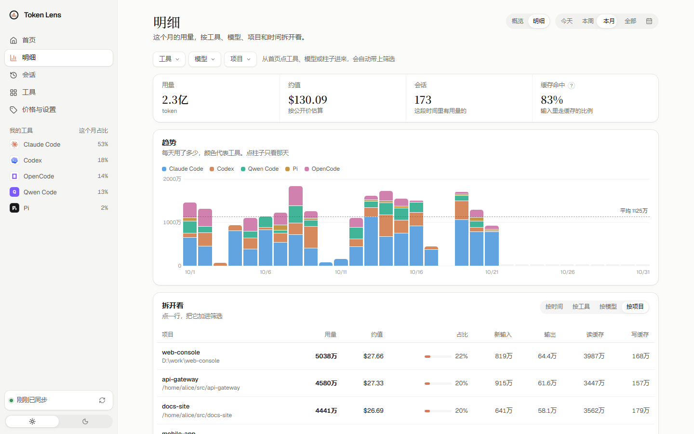

<div align="center">


# Token Lens

Local-only token usage and cost tracking for AI coding tools

[](https://github.com/rumoii/token-lens/stargazers)
[](LICENSE)

[](PRIVACY.md)

**[Download](#download-and-install)** · [Features](#features) · [Data and privacy](#data-and-privacy) · [Build from source](#build-from-source) · [Privacy policy](PRIVACY.md) · [简体中文](README.md)

</div>

Token Lens is a desktop app. It reads the logs that 27 AI coding tools, including Claude Code, Codex, Kimi and Qwen Code, write on your machine, and shows how many tokens each tool, model, project and session used, what that would cost at each model's list price, and how long each request waited before the reply started and how fast it streamed. No sign-in, no uploads, no telemetry.

The app and the specifications are written in Simplified Chinese.

## Features

- **Overview**: tokens and estimated cost for today, this week, this month or any range, compared with the same time yesterday; hourly or daily trend charts; a year-long activity heatmap.
- **Breakdown**: split by time, tool, model or project, with stacked filters; every row shows the four token kinds: new input, output, cache read and cache write.
- **Sessions**: what each session used, how it spread across days, and which models it called.
- **Request timing**: time to first token, output speed, and average speed including the wait. Only tools whose logs record timestamps have it; gaps say why.
- **Tool sources**: which tools were found on this computer, how each one logs usage, whether it was checked against real or sample logs, and its known limitations.
- **Pricing**: list prices per model, including long-context and time-of-day pricing, shown in USD or CNY. Amounts are for comparison only and are not your bill; on a subscription plan you usually pay less.
- **AI news**: 20 official blogs, changelogs and community sources, refreshed every 30 minutes while the app is open; read and starred state stays on this computer.
- **Dark mode**, and number units in 万 / 亿 or K / M / B.

## Screenshots

<table>
  <tr>
    <td align="center"><br>Overview</td>
    <td align="center"><br>Breakdown by project</td>
  </tr>
  <tr>
    <td align="center"><br>Session detail: each request</td>
    <td align="center"><br>Sessions</td>
  </tr>
  <tr>
    <td align="center" colspan="2"><br>Dark theme</td>
  </tr>
</table>

The usage in the screenshots is synthetic demo data; project paths are fictional.

## Download and install

Download the zip for your system from [Releases](https://github.com/rumoii/token-lens/releases). Each file has a SHA-256 checksum next to it. No Node, Python or other runtime is needed.

### Windows

- Requires Windows 10 or 11, x64.
- Extract `token-lens-<version>-windows-x64.zip` anywhere and run `token-lens.exe`. Keep the exe, the DLLs and the `data/` folder together; copying the exe alone does not work.
- The program is not signed, so Windows SmartScreen may block the first run. Click "More info → Run anyway".
- To upgrade, close Token Lens and replace the folder's contents with the new version. Your usage data lives elsewhere and is not affected.
- To uninstall, delete the program folder, and the data folder if you no longer need it (see [Data and privacy](#data-and-privacy)).

### macOS

- Requires a Mac with Apple silicon (M series), macOS 12 or later.
- Extract `token-lens-<version>-macos.zip`, drag `Token Lens.app` into Applications, then open it.
- The app is not signed or notarized, so macOS reports that it cannot verify the developer on first launch. Click "Done" (not "Move to Trash"), open "System Settings → Privacy & Security" and click "Open Anyway" near the bottom. The approval applies to that copy only, so move the app into Applications before opening it, and approve it again after each upgrade.

## Usage

On first launch Token Lens lists the tools it found on this computer and, once you confirm, reads all of their logs. After that it syncs every time it opens and every 5 minutes while the window is open; "同步用量" (Sync) in the sidebar syncs on demand. Closing the window quits the app: there is no tray icon, background process or launch at login.

Opening it again brings the existing window to the front.

## Supported tools

| Client | source | Evidence | Notes |
| --- | --- | --- | --- |
| Claude Code | claude | Verified, reconciled (zero diff) | Input excludes cache reads/writes; cache writes priced in 5m/1h tiers |
| Codex CLI | codex | Verified, reconciled (zero diff) | cached ⊂ input; rollout JSONL (including .zst) |
| Qwen Code | qwen | Verified field-by-field against real samples | Input includes cache and needs subtraction; output merges thoughtsTokens |
| Pi | pi | Verified field-by-field against real samples | Session header and usage are not on the same line |
| DeepSeek Harness (DSH) | dsh | Real samples, pending verification | Session-level cumulative snapshots, full overwrite |
| Grok Build CLI | grok | Real samples, pending verification | Only turn_completed carries usage |
| Hermes Agent | hermes | Real samples, pending verification | Cumulative; two tables with different structures |
| Aider | aider | Experimental, synthetic-only | commit_hash is not used as a session identifier; reads only ~/.aider.llm.history |
| Cline / Roo Code | cline | Experimental, synthetic-only | Current Cline and Roo Code usage formats are not read yet; usage may be missing |
| CodeBuddy / WorkBuddy | codebuddy | Experimental, synthetic-only | Third-party reverse-engineering evidence; CLI projects and desktop request indexes; cache reads deducted, awaiting real samples |
| Continue.dev | continue | Experimental, synthetic-only | Single file, multiple turns |
| GitHub Copilot | copilot | Experimental, synthetic-only | data.db serves only as a one-time baseline |
| Cursor | cursor | Experimental, synthetic-only | Internal SQLite structure varies by version |
| Gemini CLI | gemini | Experimental, synthetic-only | Directory mixes in non-usage JSON |
| Block Goose | goose | Experimental, synthetic-only | Two sets of token fields |
| Kimi / Kimi Code | kimi | Experimental, synthetic-only | Directory hierarchy not uniform |
| MiMo Code | mimo | Experimental, synthetic-only | Implemented from upstream source, awaiting real samples; collected usage survives session deletion; Desktop path unconfirmed |
| MiniMax Code | minimax | Experimental, synthetic-only | Implemented from upstream source, awaiting real samples; collected usage survives rewind and session deletion |
| ZCode | zcode | Experimental, synthetic-only | Implemented from upstream source, awaiting real samples; client retains 30 days, collected usage is kept |
| Command Code | commandcode | Experimental, synthetic-only | npm 1.88.2 v3 transcripts; cache reads and writes deducted, awaiting real samples |
| AnythingLLM | anythingllm | Experimental, synthetic-only | Desktop SQLite; tokens may be estimated, caches unknown; hiding/deleting chats retains collected usage |
| OpenClaw | openclaw | Experimental, synthetic-only | Archive and active directories may overlap |
| OpenCode | opencode | Experimental, synthetic-only | v1/v2 table structures differ |
| Kilo Code | kilo | Experimental, synthetic-only | Reads only the new kilo.db; legacy JSON task directories are not supported |
| OpenHands CLI | openhands | Experimental, synthetic-only | Native CLI only; usage without response events is skipped; custom SDK scripts, ACP and remote runtimes are not supported |
| Trae / Trae CN | trae | Experimental, synthetic-only | JSONL id semantics unconfirmed |
| Zed | zed | Experimental, synthetic-only | payload may be a zstd BLOB |

Experimental = verified against synthetic samples, still waiting for real-log acceptance; real samples are welcome. Field meanings and known limitations are in the [adapter contract](specs/adapters.md) and [log field facts](specs/log-schemas.yaml).

## Data and privacy

- **Reads local logs only**: Token Lens reads only the usage metadata that the tools already wrote on this computer (the four token kinds, model, time, session, project path). It never reads or stores prompts, replies, code or credentials, and never modifies those tools' files.
- **Data stays on this computer**: usage, preferences and the news cache live in a `data` folder under the system's application support directory: `%APPDATA%\Token Lens\Token Lens\data` on Windows, `~/Library/Application Support/io.github.rumoii.token-lens/data` on macOS. Delete that folder to remove everything.
- **Only three things use the network**: AI news refreshes its sources on the schedule above; clicking "更新汇率" (Update rate) in Settings fetches one USD/CNY exchange rate; and at most once a day the app asks GitHub whether a newer release exists (you can turn this off in Settings; a new version is only announced, never downloaded automatically). None of these requests carries an account, credentials or usage data. The source list and request rules are in [specs/news.md](specs/news.md); the update check is described in [specs/update.md](specs/update.md).
- No accounts, uploads, telemetry or third-party analytics. See the [privacy policy](PRIVACY.md) for details.

## How it works

<picture>
  <source media="(prefers-color-scheme: dark)" srcset="docs/images/architecture.en-dark.svg">
  
</picture>

- The UI is Flutter. Collection, pricing and news refresh run in a Rust library shipped with the app and called in-process through flutter_rust_bridge; there is no local web server and no WebView.
- Reading the same record again never counts it twice, and usage already recorded stays even after a client prunes its logs.
- Amounts are stored as integer micro-dollars (USD × 10⁶); pricing rules are in [specs/pricing.md](specs/pricing.md).
- Per-request timings are stored separately and never change usage or cost; definitions are in [specs/stats.md](specs/stats.md).

| Directory | Contents |
| --- | --- |
| `app/` | The desktop app: Flutter UI (`app/lib/`) and Rust core (`app/rust/`) |
| `specs/` | Adapter contracts, log fields, statistics and pricing specs, news sources |
| `src/core/`, `dashboard/`, `desktop/`, `bin/` | The legacy Node/React tool, see [Legacy](#legacy-nodereact-tool) |
| `scripts/`, `test/` | Legacy scripts and tests; `scripts/parity/` uses the legacy code to generate the desktop app's parity baselines |

## Build from source

Requires Flutter 3.47.9 and Rust 1.98.0, plus the Visual Studio "Desktop development with C++" workload on Windows or Xcode on macOS.

```sh
cd app
flutter pub get --enforce-lockfile
flutter build windows --release   # or: flutter build macos --release
```

Development runs must point at a separate test data directory. Checks, code generation and the release process are described in [app/README.md](app/README.md) (Chinese).

## Legacy Node/React tool

The repository keeps the earlier tool: a Node CLI (`lens collect / summary / serve`) with a browser dashboard. Its ledger lives in `~/.token-lens`; the desktop app never opens that folder, so the two never interfere. To carry legacy data over to the desktop app, copy the ledger files as described under "运行与回退" (Running and rollback) in [app/README.md](app/README.md); to go back, close the desktop app and keep using the legacy tool.

The legacy tool requires Node.js ≥ 24.21.0:

```sh
npm ci
npm ci --prefix dashboard
npm run dashboard:build
npm start          # opens http://127.0.0.1:3456
```

CLI usage: `lens [collect|summary|reprice|serve] [--data-dir <dir>] [--port <port>]`. Always pass `--data-dir` when pointing anywhere other than a test directory. See [specs/features.md](specs/features.md) for the feature spec and [CLAUDE.md](CLAUDE.md) for data-directory rules and test conventions.

## Documentation

The specifications are written in Simplified Chinese.

| Document | Description |
| --- | --- |
| [specs/desktop.md](specs/desktop.md) | Desktop app technical decisions |
| [specs/stats.md](specs/stats.md) | Statistics, timing and UI rules |
| [specs/news.md](specs/news.md) | News sources and network boundary |
| [specs/update.md](specs/update.md) | Update check requests and boundary |
| [specs/adapters.md](specs/adapters.md) | Adapter contract |
| [specs/log-schemas.yaml](specs/log-schemas.yaml) | Log field facts |
| [specs/pricing.md](specs/pricing.md) | Pricing contract |
| [CONTRIBUTING.md](CONTRIBUTING.md) | Contributing guide |
| [SECURITY.md](SECURITY.md) | Security policy |
| [PRIVACY.md](PRIVACY.md) | Privacy policy |
| [THIRD_PARTY_NOTICES.md](THIRD_PARTY_NOTICES.md) | Third-party notices |

## Contributing

Issues and pull requests are welcome; please read the [contributing guide](CONTRIBUTING.md) first. Reports of log formats that don't match, and real log samples for the experimental tools, are especially helpful.

## Star history

<a href="https://star-history.com/#rumoii/token-lens&Date">
  <picture>
    <source media="(prefers-color-scheme: dark)" srcset="https://api.star-history.com/svg?repos=rumoii/token-lens&type=Date&theme=dark">
    
  </picture>
</a>

## License

[MIT](LICENSE), `Copyright (c) 2026 rumoii`. Third-party component licenses are listed in [Third-party notices](THIRD_PARTY_NOTICES.md).
