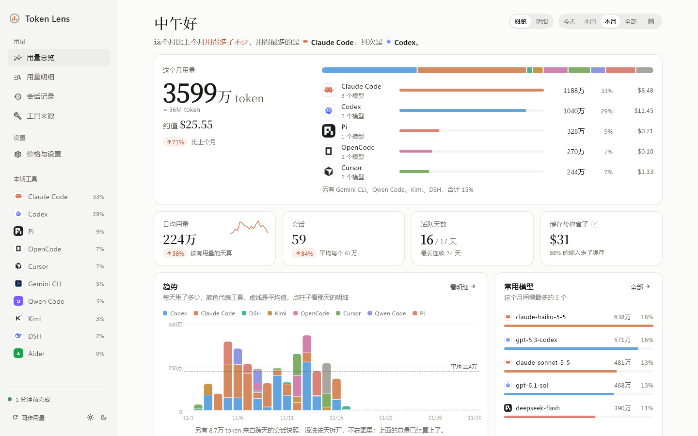
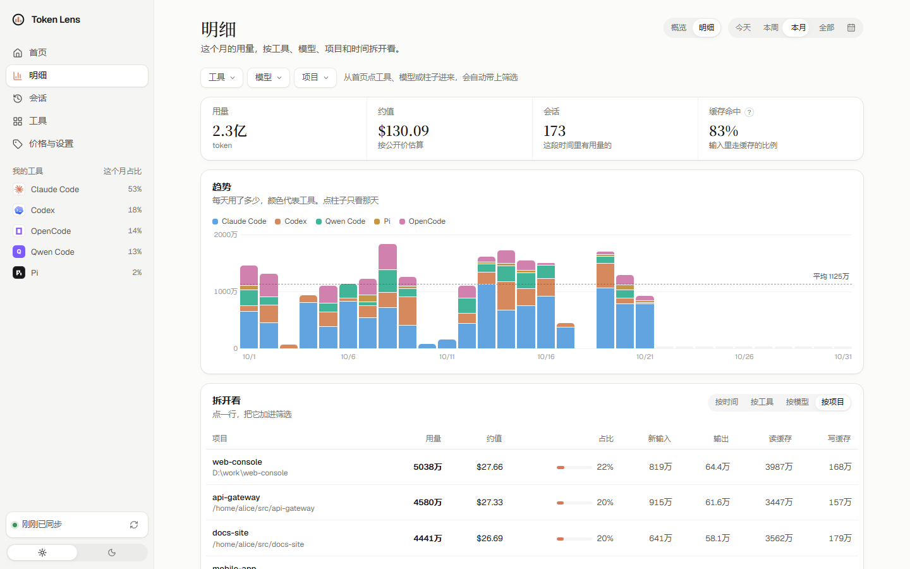
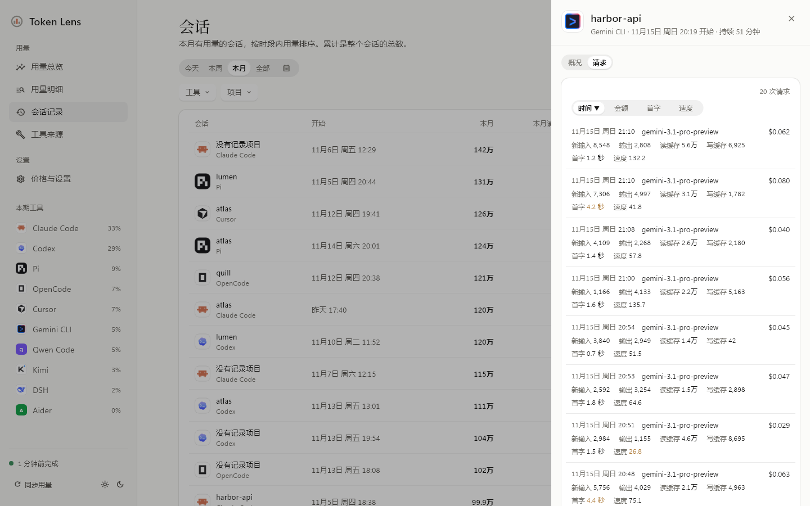
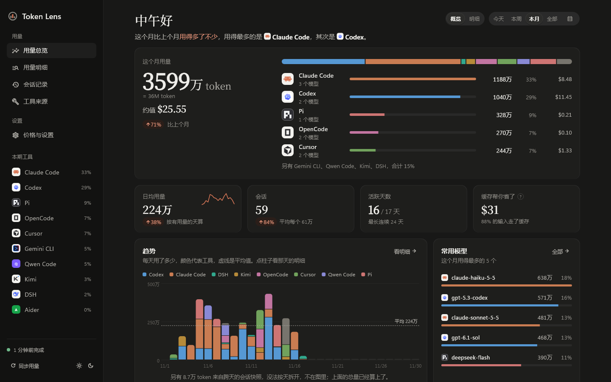
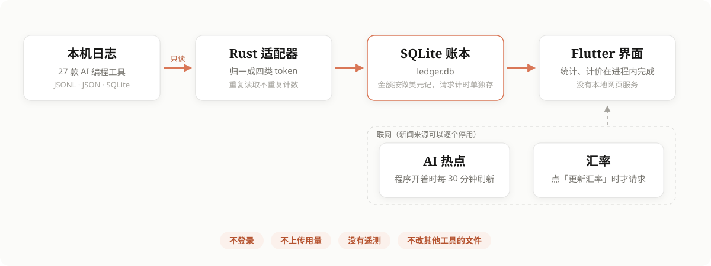

<div align="center">


# Token Lens

纯本地的 AI 编程工具 token 用量与花费统计

[](https://github.com/rumoii/token-lens/stargazers)
[](LICENSE)

[](PRIVACY.md)

**[下载](#下载与安装)** · [功能](#功能) · [数据与隐私](#数据与隐私) · [从源码构建](#从源码构建) · [隐私说明](PRIVACY.md) · [English](README.en.md)

</div>

Token Lens 是一个桌面应用。它读取 Claude Code、Codex、Kimi、Qwen Code 等 28 款 AI 编程工具写在本机的日志，算出每个工具、模型、项目、会话用了多少 token，按各模型的公开价估算值多少钱，还能看到每次请求要等多久才开始回复、回复得多快。不登录、不上传、没有遥测。

## 功能

- **用量总览**：今天、本周、本月、昨天、上周、上个月、最近 7 天或 30 天，以及任意时段用了多少 token，约值多少，比上一期多了还是少了；点开能看到是哪些项目、工具或模型多了、少了；按小时或按天的趋势图，可切换看 token 或金额；一年的活跃热力图。
- **明细**：按时间、工具、模型、项目拆开看，可以叠加筛选，筛选项多时能搜索；每一行都能看到新输入、输出、读缓存、写缓存四类 token，也可以并排列出上一期和差额。
- **会话**：每个会话用了多少、按天怎么分布、用了哪些模型；能按项目、会话 ID、工具或模型搜索，按用量、金额、开始时间、最近活动或请求数排序。
- **请求计时**：首字（开始回复前要等多久）、速度（回复时每秒出多少 token）、平均速度（算上等待）。只有日志里记了时间的工具才有，缺的地方会写明原因。
- **工具来源**：全部支持的工具各去哪几个目录找日志、找到没有、没找到是没装还是没有权限；每个工具的日志怎么记、用真实日志还是样例日志核对过、有哪些已知限制。不想看的工具可以隐藏，只影响显示，照常记账。
- **同步状态**：同步中、第一次同步的进度、同步失败或有异常，都会在数据页顶部提示。
- **价格**：各模型的公开价、长上下文和分时段计价，按美元或人民币显示。金额只用来比较和感知，不是你的账单；用套餐的话，实际花费通常更低。
- **AI 热点**：20 个官方博客、更新日志和社区来源的新闻，程序开着时每 30 分钟刷新一次；已读和收藏只存在本机。不需要的话，可以在首次引导里勾选“只用本地统计”，或之后在设置里关掉，关掉后不再联网取新闻。
- **导出与命令行**：明细可以导出成 CSV 或 JSON；随程序附带的 `token-lens-cli` 用 JSON 输出用量、花费和会话，给脚本和 AI 助手用。
- **中文和英文界面**，默认跟随系统语言；深色模式；数字单位可选“万 / 亿”或“K / M / B”。
- **显示设置**：紧凑模式一屏看更多行；界面缩放 90%–125%，在系统缩放的基础上再调；打开时停在哪个时段；每周从周一还是周日开始。

## 截图

<table>
  <tr>
    <td align="center"><br>首页概览</td>
    <td align="center"><br>明细：按项目拆开</td>
  </tr>
  <tr>
    <td align="center"><br>会话详情：每次请求</td>
    <td align="center"><br>会话列表</td>
  </tr>
  <tr>
    <td align="center" colspan="2"><br>深色主题</td>
  </tr>
</table>

截图里的用量是合成的演示数据，项目路径均为虚构。

## 下载与安装

从 [Releases](https://github.com/rumoii/token-lens/releases) 下载对应系统的 zip，每个文件旁边有同名的 `.sha256` 校验文件。不需要安装 Node、Python 或其他运行环境。

想确认下载完整：Windows 在 PowerShell 里运行 `Get-FileHash .\token-lens-<版本>-windows-x64.zip`，把输出的哈希和 `.sha256` 文件里的对一下（大小写不同不要紧）；macOS 把两个文件放在同一个文件夹，在终端里运行 `shasum -a 256 -c token-lens-<版本>-macos.zip.sha256`，看到 `OK` 即可。

### Windows

- 系统要求：Windows 10 / 11，x64。
- 把 `token-lens-<版本>-windows-x64.zip` 解压到任意文件夹，双击里面的 `token-lens.exe`。文件夹里的 exe、DLL 和 `data/` 要放在一起，不能只复制 exe。
- 程序没有签名，第一次运行时 Windows SmartScreen 可能拦截，点「更多信息 → 仍要运行」。
- 升级：关掉 Token Lens，用新版解压出的文件替换旧文件夹的内容。用量数据不在这个文件夹里，替换不会丢数据。
- 卸载：删掉程序文件夹；不再需要数据时，再删掉数据目录（见[数据与隐私](#数据与隐私)）。

### macOS

- 系统要求：Apple 芯片（M 系列）的 Mac，macOS 12 或更新。
- 解压 `token-lens-<版本>-macos.zip`，把 `Token Lens.app` 拖进「应用程序」再打开。
- 升级：关掉 Token Lens，用新的 `Token Lens.app` 替换「应用程序」里的旧版。卸载：删掉 `Token Lens.app`；不再需要数据时，再删掉数据目录（见[数据与隐私](#数据与隐私)）。
- 程序没有签名和公证，第一次打开时系统会提示无法验证开发者。点「完成」（不要点「移到废纸篓」），到「系统设置 → 隐私与安全性」（macOS 12 是「系统偏好设置 → 安全性与隐私 → 通用」），在下方点「仍要打开」。放行只对当时那一份程序有效，所以先拖进「应用程序」再打开；升级替换后要再放行一次。

## 使用

第一次打开时，Token Lens 会列出在这台电脑上找到的工具，点「开始统计」后才读取日志内容，第一遍会读完全部日志。之后每次打开都会同步一次，窗口开着时每 5 分钟同步一次，也可以随时点「同步用量」。关掉窗口程序就退出，不留后台进程，也不开机自启。

重复打开时只会激活已经开着的那个窗口。

### 导出和命令行

「明细」页下方的「导出」把当前筛选和分组存成 CSV 或 JSON，放进“下载”文件夹。项目默认只写名字，勾选「包含完整项目路径」才写路径。

`token-lens-cli` 和程序放在一起：Windows 是解压文件夹里的 `token-lens-cli.exe`，macOS 是 `Token Lens.app/Contents/MacOS/token-lens-cli`。它读同一个账本，每条命令输出一个 JSON 对象。

```sh
token-lens-cli status                          # 账本和上次同步
token-lens-cli summary --period week --compare # 本周用量、花费，和上周比
token-lens-cli breakdown --by model            # 按模型拆开
token-lens-cli sessions --sort cost --limit 10 # 最贵的 10 个会话
token-lens-cli sync                            # 同步一次
```

除了 `sync`，命令都只读账本，不联网，也不会触发同步；结果里的 `freshness` 写明数据是什么时候同步的。完整说明和退出码见 [specs/cli.md](specs/cli.md)。

## 支持的工具

| 客户端 | source | 证据 | 备注 |
| --- | --- | --- | --- |
| Claude Code | claude | 实测·对账零差异 | 输入不含缓存读写；缓存写分 5m/1h 档计价 |
| Codex CLI | codex | 实测·对账零差异 | cached ⊂ input；rollout JSONL（含 .zst） |
| Qwen Code | qwen | 实测·逐字段对照 | 输入含缓存需扣减；输出并入 thoughtsTokens |
| Pi | pi | 实测·逐字段对照 | 会话头与用量不在同一行 |
| DeepSeek Harness (DSH) | dsh | 实测·与客户端自报对照 | 会话级累计快照，全量覆写 |
| Antigravity CLI (agy) | antigravity | 实测·与客户端自报对照 | 每个会话一个 SQLite；输入不含读缓存，输出含思考；不报告写缓存 |
| Grok Build CLI | grok | 有样本·待对照 | 仅 turn_completed 带用量 |
| Hermes Agent | hermes | 有样本·待对照 | 累计；两张表结构不同 |
| Aider | aider | 实验性·合成验证 | commit_hash 不作会话标识；只读取 ~/.aider.llm.history |
| Cline / Roo Code | cline | 实验性·合成验证 | 当前 Cline 与 Roo Code 的用量格式尚未接入，可能读不到 |
| CodeBuddy / WorkBuddy | codebuddy | 实验性·合成验证 | 第三方逆向依据；CLI projects 与桌面请求索引；输入扣缓存读，待真实样本 |
| Continue.dev | continue | 实验性·合成验证 | 单文件多轮 |
| GitHub Copilot | copilot | 实验性·合成验证 | data.db 只作一次性基线 |
| Cursor | cursor | 实验性·合成验证 | 内部 SQLite 结构随版本变化 |
| Gemini CLI | gemini | 实验性·合成验证 | 目录混有非用量 JSON |
| Block Goose | goose | 实验性·合成验证 | 两套 token 字段 |
| Kimi / Kimi Code | kimi | 实测·与客户端自报对照 | 目录层级不统一 |
| MiMo Code | mimo | 实验性·合成验证 | 按上游源码实现，待真实样本；删会话后已采集用量保留；Desktop 路径未核实 |
| MiniMax Code | minimax | 实验性·合成验证 | 按上游源码实现，待真实样本；rewind 或删会话后已采集用量保留 |
| ZCode | zcode | 实验性·合成验证 | 按上游源码实现，待真实样本；客户端保留 30 天，已采集用量保留 |
| Command Code | commandcode | 实验性·合成验证 | npm 1.88.2 v3 transcript；输入扣缓存读写，待真实样本 |
| AnythingLLM | anythingllm | 实验性·合成验证 | 桌面 SQLite；token 可能为估算，缓存未知；隐藏/删除不撤销已采集用量 |
| OpenClaw | openclaw | 实验性·合成验证 | 归档与活跃目录可能重复 |
| OpenCode | opencode | 实验性·合成验证 | v1/v2 表结构不同 |
| Kilo Code | kilo | 实验性·合成验证 | 只读新版 kilo.db；旧版 JSON 任务目录未接入 |
| OpenHands CLI | openhands | 实验性·合成验证 | 仅原生 CLI；无响应事件的用量跳过，SDK 自定义脚本、ACP 与远程 runtime 未接入 |
| Trae / Trae CN | trae | 实验性·合成验证 | JSONL id 语义未确认 |
| Zed | zed | 实验性·合成验证 | payload 可能是 zstd BLOB |

实测 = 用真实日志核对过（逐字段手核、与客户端自报的总量对照，或与账本对账）；这些核对最初在旧版上做，桌面版又在同一份真实日志上与旧版逐字段一致。有样本·待对照 = 有真实日志，但用量太少或没有可对照的数字。实验性 = 合成样本验证通过、还缺真实日志验收，欢迎反馈真实样本。各工具的字段含义和已知限制见 [适配器契约](specs/adapters.md) 与 [日志字段事实](specs/log-schemas.yaml)。

## 数据与隐私

- **只读本机日志**：在本机读取并解析各工具的日志，只提取用量元数据（四类 token、模型、时间、会话、项目路径）；日志里的提示词、回复、代码和凭据不会写进账本，也不会发出去。不修改这些工具的任何文件。
- **数据只在本机**：用量、偏好和新闻缓存都在系统的应用支持目录下的 `data` 文件夹里：Windows 上是 `%APPDATA%\Token Lens\Token Lens\data`，macOS 上是 `~/Library/Application Support/io.github.rumoii.token-lens/data`。不再需要时整个删掉即可。
- **会联网的只有三件事**：AI 热点开着时按上面的时间刷新新闻来源；在设置里点「更新汇率」时取一次美元兑人民币汇率；每天最多一次向 GitHub 查询有没有新版本（可在设置里关掉，有新版只提示，不自动下载）。请求不带账号、凭据或用量数据。来源清单和请求方式见 [specs/news.md](specs/news.md)，检查更新见 [specs/update.md](specs/update.md)。
- 没有账号、上传、遥测或第三方分析。完整说明见 [隐私说明](PRIVACY.md)。

## 工作原理

<picture>
  <source media="(prefers-color-scheme: dark)" srcset="docs/images/architecture-dark.svg">
  
</picture>

- 界面是 Flutter，统计、计价和新闻刷新都在随程序分发的 Rust 库里，通过 flutter_rust_bridge 在进程内调用；没有本地网页服务，也不用 WebView。
- 同一条记录重复读取不会重复计数；日志被客户端清理后，已经记下的用量仍然保留。
- 金额以整数微美元（USD × 10⁶）存储，计价规则见 [specs/pricing.md](specs/pricing.md)。
- 每次请求的计时单独存放，不影响用量和金额，口径见 [specs/stats.md](specs/stats.md)。

| 目录 | 内容 |
| --- | --- |
| `app/` | 桌面应用：Flutter 界面（`app/lib/`）和 Rust 核心（`app/rust/`） |
| `specs/` | 适配器契约、日志字段、统计与计价规格、新闻来源 |
| `src/core/`、`dashboard/`、`desktop/`、`bin/` | 旧版 Node/React 统计工具，见[旧版](#旧版-nodereact) |
| `scripts/`、`test/` | 旧版的脚本和测试；`scripts/parity/` 用旧版生成桌面版对拍用的基准数据 |

## 从源码构建

需要 Flutter 3.47.9、Rust 1.98.0；Windows 还要 Visual Studio 的 C++ 桌面开发组件和创建符号链接的权限（打开 Windows 的开发者模式即可），macOS 要 Xcode。

```sh
cd app
flutter pub get --enforce-lockfile
flutter build windows --release   # 或 flutter build macos --release
```

产物在 `app/build/windows/x64/runner/Release/`（macOS 是 `app/build/macos/Build/Products/Release/Token Lens.app`）。开发运行必须同时隔离测试数据目录和日志根目录，检查命令、代码生成和发布流程见 [app/README.md](app/README.md#开发与检查)。

## 旧版 Node/React

仓库里保留了旧版：Node CLI（`lens collect / summary / serve`）加浏览器看板。它的账本在 `~/.token-lens`，桌面版从不打开这个目录，两者互不影响。想把旧版积累的数据带到桌面版，按 [app/README.md](app/README.md) 的「运行与回退」复制账本文件；想退回旧版，关掉桌面版继续用旧版即可。

旧版需要 Node.js ≥ 24.21.0：

```sh
npm ci
npm ci --prefix dashboard
npm run dashboard:build
npm start          # 启动本地看板，终端会打印地址（默认 http://127.0.0.1:3456，端口被占用时顺延），在浏览器里打开它
```

CLI 用法：`node bin/lens.js [collect|summary|reprice|serve] [--data-dir <dir>] [--port <port>]`。指向测试目录以外的地方时，一律显式传 `--data-dir`。功能规格见 [specs/features.md](specs/features.md)，数据目录规则和测试约定见 [CLAUDE.md](CLAUDE.md)。

## 文档索引

规格文档以简体中文撰写。

| 文档 | 说明 |
| --- | --- |
| [specs/desktop.md](specs/desktop.md) | 桌面应用的技术决定 |
| [specs/stats.md](specs/stats.md) | 统计、计时与界面规则 |
| [specs/news.md](specs/news.md) | 新闻来源与联网边界 |
| [specs/update.md](specs/update.md) | 检查更新的请求与边界 |
| [specs/cli.md](specs/cli.md) | 命令行与导出的输出契约 |
| [specs/adapters.md](specs/adapters.md) | 适配器契约 |
| [specs/log-schemas.yaml](specs/log-schemas.yaml) | 日志字段事实 |
| [specs/pricing.md](specs/pricing.md) | 定价契约 |
| [CONTRIBUTING.md](CONTRIBUTING.md) | 贡献指南 |
| [SECURITY.md](SECURITY.md) | 安全政策 |
| [PRIVACY.md](PRIVACY.md) | 隐私说明 |
| [THIRD_PARTY_NOTICES.md](THIRD_PARTY_NOTICES.md) | 第三方声明 |

## 贡献

欢迎 Issue 与 PR。提交前请读 [贡献指南](CONTRIBUTING.md)。工具日志格式对不上、或者你有某个实验性工具的真实日志样本，特别欢迎反馈；样本只需要和用量有关的几个字段，提交前请删掉提示词、回复、路径和账号信息。

## Star 趋势

<a href="https://star-history.com/#rumoii/token-lens&Date">
  <picture>
    <source media="(prefers-color-scheme: dark)" srcset="https://api.star-history.com/svg?repos=rumoii/token-lens&type=Date&theme=dark">
    
  </picture>
</a>

## 许可

[MIT](LICENSE)，`Copyright (c) 2026 rumoii`。第三方组件的许可见 [第三方声明](THIRD_PARTY_NOTICES.md)。
