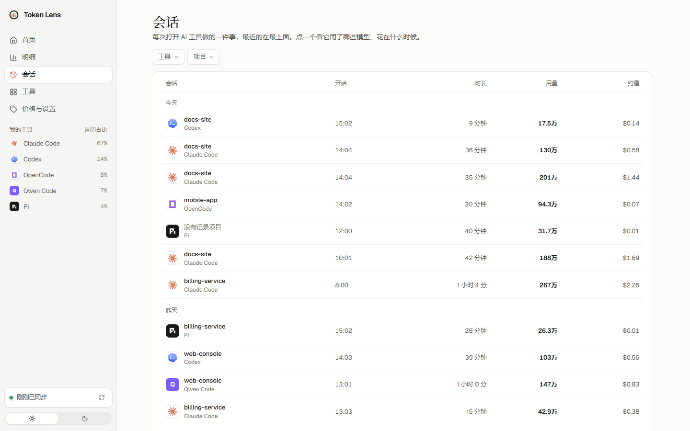
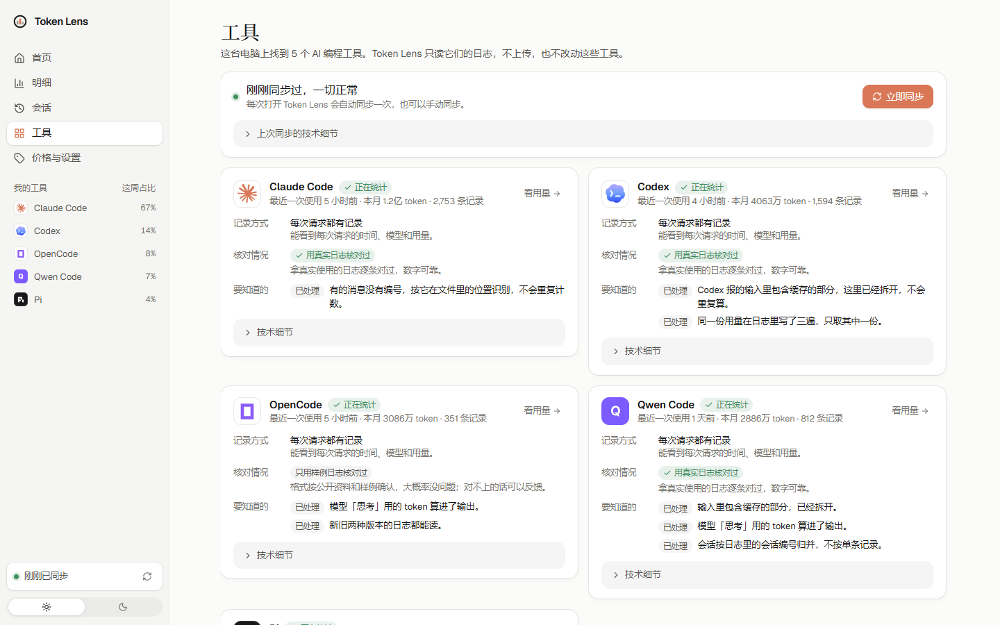

<div align="center">


# Token Lens

纯本地的 AI 编码工具 Token 用量与成本分析

[](https://github.com/rumoii/token-lens/stargazers)
[](LICENSE)


[](PRIVACY.md)

**[安装](#安装)** · [使用](#使用) · [工作原理](#工作原理) · [隐私说明](PRIVACY.md) · [English](README.en.md)

</div>

Token Lens 读取 Claude Code、Codex CLI、Qwen Code 等 27 款 AI 编码工具写在本机的日志，汇总成 token 用量和按公开价估算的花费，在本地看板上按工具、模型、项目和时间拆开看。Windows 和 Apple 芯片的 Mac 上可以用桌面版直接打开窗口，其他系统在浏览器里打开。不登录、不上传、零遥测。

## 功能

- **100% 本地隐私**：只读解析本地日志，零上传、零遥测、无账号。
- **零重依赖**：核心只用 Node 内置模块（`node:sqlite` + `node:http`），`dependencies` 为空。
- **原子去重**：SHA-256 内容哈希幂等入库，金额以整数微美元存储。
- **自动同步**：`serve` 运行中每 5 分钟增量同步，启动时补采一次（账本为空时不补采）。
- **27 组客户端适配器**：覆盖主流 AI 编码客户端的本地日志与本地数据库。
- **显示偏好**：金额只支持 USD/CNY，只有点击「更新汇率」才联网；共享外壳文案支持 zh-CN 和 en，页面正文为中文。
- **桌面版**：Windows 是单个免安装 exe（不超过 30MB），Apple 芯片的 Mac 是 dmg；双击打开窗口，不需要另装 Node。

## 截图

<table>
  <tr>
    <td align="center"><br>首页概览</td>
    <td align="center"><br>明细：按项目拆开</td>
  </tr>
  <tr>
    <td align="center"><br>会话列表</td>
    <td align="center"><br>工具与核对情况</td>
  </tr>
  <tr>
    <td align="center" colspan="2"><br>深色主题</td>
  </tr>
</table>

截图里的用量是合成的演示数据，项目路径均为虚构。

## 支持矩阵

| 客户端 | source | 证据 | 备注 |
| --- | --- | --- | --- |
| Claude Code | claude | 实测·对账零差异 | 输入不含缓存读写；缓存写分 5m/1h 档计价（158 条可对照） |
| Codex CLI | codex | 实测·对账零差异 | cached ⊂ input；rollout JSONL（含 .zst）（1,251 条可对照） |
| Qwen Code | qwen | 实测·逐字段对照 | 输入含缓存需扣减；输出并入 thoughtsTokens |
| Pi | pi | 实测·逐字段对照 | 会话头与用量不在同一行 |
| DeepSeek Harness (DSH) | dsh | 有样本·待对照 | 会话级累计快照，全量覆写 |
| Grok Build CLI | grok | 有样本·待对照 | 仅 turn_completed 带用量 |
| Hermes Agent | hermes | 有样本·待对照 | 累计；两张表结构不同 |
| Aider | aider | 实验性·合成验证 | commit_hash 不作会话标识；只读取 ~/.aider.llm.history |
| Cline / Roo Code | cline | 实验性·合成验证 | 当前 Cline 与 Roo Code 的用量格式尚未接入，可能读不到 |
| CodeBuddy / WorkBuddy | codebuddy | 实验性·合成验证 | 第三方逆向依据；CLI projects 与桌面请求索引；输入扣缓存读，待真实样本 |
| Continue.dev | continue | 实验性·合成验证 | 单文件多轮 |
| GitHub Copilot | copilot | 实验性·合成验证 | data.db 只作一次性基线 |
| Cursor | cursor | 实验性·合成验证 | 内部 SQLite 结构随版本变化 |
| Gemini CLI | gemini | 实验性·合成验证 | 目录混有非用量 JSON |
| Block Goose | goose | 实验性·合成验证 | 两套 token 字段 |
| Kimi / Kimi Code | kimi | 实验性·合成验证 | 目录层级不统一 |
| MiMo Code | mimo | 实验性·合成验证 | 按上游源码实现，待真实样本；删会话后已采集用量保留；Desktop 路径未核实 |
| MiniMax Code | minimax | 实验性·合成验证 | 按上游源码实现，待真实样本；rewind 或删会话后已采集用量保留 |
| ZCode | zcode | 实验性·合成验证 | 按上游源码实现，待真实样本；客户端保留 30 天，已采集用量保留 |
| Command Code | commandcode | 实验性·合成验证 | npm 1.88.2 v3 transcript；输入扣缓存读写，待真实样本 |
| AnythingLLM | anythingllm | 实验性·合成验证 | 桌面 SQLite；token 可能为估算，缓存未知；隐藏/删除不撤销已采集用量 |
| OpenClaw | openclaw | 实验性·合成验证 | 归档与活跃目录可能重复 |
| OpenCode | opencode | 实验性·合成验证 | v1/v2 表结构不同 |
| Kilo Code | kilo | 实验性·合成验证 | 只读新版 kilo.db；旧版 JSON 任务目录未接入 |
| OpenHands CLI | openhands | 实验性·合成验证 | 仅原生 CLI；无响应事件的用量跳过，SDK 自定义脚本、ACP 与远程 runtime 未接入 |
| Trae / Trae CN | trae | 实验性·合成验证 | JSONL id 语义未确认 |
| Zed | zed | 实验性·合成验证 | payload 可能是 zstd BLOB |

实验性 = 合成样本验证通过、现场待验收，欢迎反馈真实样本。完整契约与已知限制见 [完整契约与已知限制](specs/adapters.md) 与 [日志字段事实](specs/log-schemas.yaml)。

## 安装

### Windows 桌面版

单个自解压 exe，双击即用：不需要安装 Node，没有安装向导，不写注册表。

- 系统要求：Windows 10 / 11 x64，系统里已有 Microsoft Edge WebView2 Runtime（Windows 11 自带；Windows 10 一般随 Edge 装好，没有时从微软官网安装）。
- 首次运行把程序解压到 `%LOCALAPPDATA%\token-lens-app\<版本>\`，之后双击直接启动。
- 数据目录与 CLI 共用：默认 `~/.token-lens`，同样认 `TOKEN_LENS_DATA_DIR`。
- 窗口先用已有数据打开，再在后台补采一次；窗口开着时每 5 分钟同步一次。关窗即退出，没有托盘、后台进程或开机自启。
- 固定使用端口 3456（端口一变，看板设置就会丢失）。端口被占用时，窗口显示原因和日志位置，不会换端口。
- exe 没有签名，首次运行时 Windows SmartScreen 可能拦截，点「更多信息 → 仍要运行」。
- 升级：运行新版 exe，它会解压到新的版本目录。旧版本目录不会自动删除，可以手动删掉。

目前没有发布现成的 exe，需要从源码构建。前置：Rust stable（MSVC 工具链，需要 Visual Studio 生成工具）和官方 Node.js v24 x64。

```powershell
npm ci --prefix dashboard
npm run dashboard:build
cargo fetch --locked --manifest-path desktop/Cargo.toml
$env:TOKEN_LENS_DIST_DIR = "$PWD\dashboard\dist"
node desktop/build.mjs
```

产物在 `desktop/dist/token-lens-<版本>-<哈希>.exe`。打包进去的是 PATH 上的 `node.exe`，也可以用 `TOKEN_LENS_NODE_EXE` 指定，必须是 v24。exe 超过 30,000,000 字节时构建失败。

### macOS 桌面版

dmg 里是一个标准的 `.app`，拖进「应用程序」就能用，不需要安装 Node。

- 系统要求：Apple 芯片（M 系列）的 Mac，macOS 13.5 或更新；不支持 Intel Mac。
- 数据目录、同步方式和端口与 Windows 版相同：默认 `~/.token-lens`，固定端口 3456。关窗或按 ⌘Q 即退出。
- 看板设置不在数据目录里，存在 `~/Library/WebKit/io.github.rumoii.token-lens`。
- 应用只做了 ad-hoc 签名，没有经过 Apple 公证，第一次打开时系统会提示「未打开 "Token Lens"」。这时点「完成」（不要点「移到废纸篓」），再到「系统设置 → 隐私与安全性」，在下方点「仍要打开」。
- 放行只对当时那一份程序有效，所以先拖进「应用程序」再打开。从 dmg 里直接打开并放行过的，拖进「应用程序」后还要再放行一次。
- 升级：把新版 `.app` 拖进「应用程序」替换旧版，然后按上面的方法再放行一次。

目前没有发布现成的 dmg，需要在 Apple 芯片的 Mac 上从源码构建。前置：Xcode Command Line Tools、Rust stable，以及 nodejs.org 的官方 Node.js v24 arm64。Homebrew 装的 node 会被构建脚本拒绝，因为它依赖 Homebrew 的动态库。

```sh
npm ci --prefix dashboard
npm run dashboard:build
cargo fetch --locked --manifest-path desktop/Cargo.toml
TOKEN_LENS_DIST_DIR="$PWD/dashboard/dist" node desktop/build.mjs
```

产物在 `desktop/dist/token-lens-<版本>-<哈希>-macos-arm64.dmg`。打包进去的是 PATH 上的 `node`，也可以用 `TOKEN_LENS_NODE_EXE` 指定，必须是 v24。dmg 超过 37,000,000 字节时构建失败。

### 从源码运行的前置要求

- Node.js >= 24.21.0（核心用到 `node:sqlite`）
- npm
- Windows / macOS / Linux
- 不需要任何云账户

### 从源码安装

```sh
npm ci
npm ci --prefix dashboard
npm run dashboard:build
npm start
```

启动后访问 http://127.0.0.1:3456 。

### CLI 安装

仓库 `private: true`，未发布到 registry，两种本地方式任选：

- 在仓库根执行 `npm link`，得到 `lens` / `token-lens` 命令；
- 或直接 `node bin/lens.js <command>`。

示例：

```sh
node bin/lens.js collect --data-dir .tmp/lens-demo
```

## 使用

```sh
npm run collect    # 采集本地日志
npm run summary    # 打印终端用量摘要
npm start          # 启动本地看板
```

CLI 用法：`lens [collect|summary|reprice|serve] [--data-dir <dir>] [--port <port>]`

- `serve` 的端口 3456 被占用时自动顺延（桌面版固定 3456，不顺延）。
- `serve` 启动时补采一次（账本为空时不补采），运行中每 5 分钟增量同步。
- 数据目录裁决顺序：`--data-dir` > `TOKEN_LENS_DATA_DIR` > `DB_PATH` > `~/.token-lens`；`DB_PATH` 与 `--data-dir`/`TOKEN_LENS_DATA_DIR` 指向不同目录时报错。

## 工作原理

<p align="center">
  
</p>

- `usage_records` 表 + SHA-256 内容哈希幂等去重。
- 金额以整数微美元（USD × 1e6）存储。
- 日志解析只读、不执行代码（JSON/JSONL/SQLite 只读解析 + zstd 多帧解码）。
- 桌面版由窗口拉起同一个 `lens serve`；窗口只加载 `http://127.0.0.1:3456`，其他链接交给系统浏览器打开。
- 安全边界：服务仅绑 127.0.0.1（从不绑 0.0.0.0）；`/api/*` 需 bearer token（存 `<data-dir>/api-token`，0600）；拒绝非回环 Host；写操作要求同源或无 Origin；永不发 CORS 头。

| 目录 | 内容 |
| --- | --- |
| `src/core/` | CLI、日志发现、适配器、账本、计价与本地 HTTP 服务 |
| `dashboard/` | 看板界面（React + Vite），构建到 `dashboard/dist` |
| `desktop/` | 桌面壳（Rust + wry）、Windows 自解压与 macOS dmg 打包 |
| `specs/` | 适配器契约、日志字段、API 与定价规格、路线图 |
| `scripts/` | 图标生成与对账脚本 |
| `test/` | 核心测试与脱敏后的真实样本夹具 |

## 升级与数据

- 升级：`git pull`，然后重新执行 `npm ci`、`npm ci --prefix dashboard`、`npm run dashboard:build`。
- 数据都在数据目录（默认 `~/.token-lens`）：账本 `ledger.db` 和看板令牌 `api-token`；桌面版另有 `logs/`（内核日志，最多 3 个 5MiB 文件轮转），Windows 桌面版还有 `webview/`（窗口的浏览器数据，含看板设置；macOS 上这部分在 `~/Library/WebKit/io.github.rumoii.token-lens`）。升级前先停掉 `lens serve` 或关掉桌面窗口，再整个目录复制一份备份；账本开着 WAL，只复制 `ledger.db` 可能漏掉最近的写入。
- 新版本第一次打开账本时会自动升级结构，在一个事务里完成，只加列、不重算历史记录。
- 回退到旧版本时，旧程序会拒绝写入结构更新的账本。这时请用升级前的备份，不要删库重建。

## 开发

前置：

```sh
npm ci
npm ci --prefix dashboard
```

| 命令 | 作用 |
| --- | --- |
| `npm run dashboard:build` | Vite 构建仪表盘 |
| `npm run dashboard:typecheck` | `tsc --noEmit` 类型检查 |
| `npm test` / `npm run test:core` | 隔离环境下运行核心测试（`node --test test/core/*.test.js`） |
| `npm run dashboard:test` | 隔离环境下运行完整前端测试（Vitest） |
| `npm run ci:local` | 隔离聚合检查：核心测试 + 前端测试 + 仪表盘构建 + 类型检查 |
| `npm start` | 启动本地看板 |
| `npm run collect` | 采集本地日志 |
| `npm run summary` | 打印终端用量摘要 |
| `node desktop/build.mjs` | 在 Windows 上构建 exe、在 Mac 上构建 dmg（见「Windows 桌面版」「macOS 桌面版」） |

<details><summary>测试约定</summary>

### 测试约定

- 测试一律使用临时 HOME、临时数据目录或 `:memory:`，绝不指向真实 HOME（本机可能有已安装版本在同步 `~/.token-lens`）。
- 非测试代码路径一律显式传 `--data-dir` 或设 `TOKEN_LENS_DATA_DIR`。
- 每个客户端一个测试文件（`test/core/`）。
- 适配器验收用例见 [specs/adapters.md](specs/adapters.md)。

</details>

## 文档索引

specs 与配套文档以简体中文撰写。

| 文档 | 说明 |
| --- | --- |
| [specs/features.md](specs/features.md) | 功能规格 |
| [specs/adapters.md](specs/adapters.md) | 适配器契约 |
| [specs/log-schemas.yaml](specs/log-schemas.yaml) | 日志字段事实 |
| [specs/api-v1.md](specs/api-v1.md) | API 契约 |
| [specs/pricing.md](specs/pricing.md) | 定价契约 |
| [specs/roadmap.md](specs/roadmap.md) | 路线图 |
| [CONTRIBUTING.md](CONTRIBUTING.md) | 贡献指南 |
| [SECURITY.md](SECURITY.md) | 安全政策 |
| [PRIVACY.md](PRIVACY.md) | 隐私说明 |
| [THIRD_PARTY_NOTICES.md](THIRD_PARTY_NOTICES.md) | 第三方声明 |
| [CLAUDE.md](CLAUDE.md) | 开发约定（agent 开发约定文档） |

## 隐私

所有解析都在本机完成，不上传任何日志或用量数据，无账号、无遥测。数据落在你指定的数据目录（默认 `~/.token-lens`），随时可整目录删除。详见 [隐私说明](PRIVACY.md)。

## 贡献

欢迎 Issue 与 PR。提交前请读 [贡献指南](CONTRIBUTING.md)。

## Star 趋势

<a href="https://star-history.com/#rumoii/token-lens&Date">
  <picture>
    <source media="(prefers-color-scheme: dark)" srcset="https://api.star-history.com/svg?repos=rumoii/token-lens&type=Date&theme=dark">
    
  </picture>
</a>

## 致谢与第三方

前端构建于 React 生态等开源组件，清单与许可证见 [第三方声明](THIRD_PARTY_NOTICES.md)。

## 许可

[MIT](LICENSE)，`Copyright (c) 2026 rumoii`。
